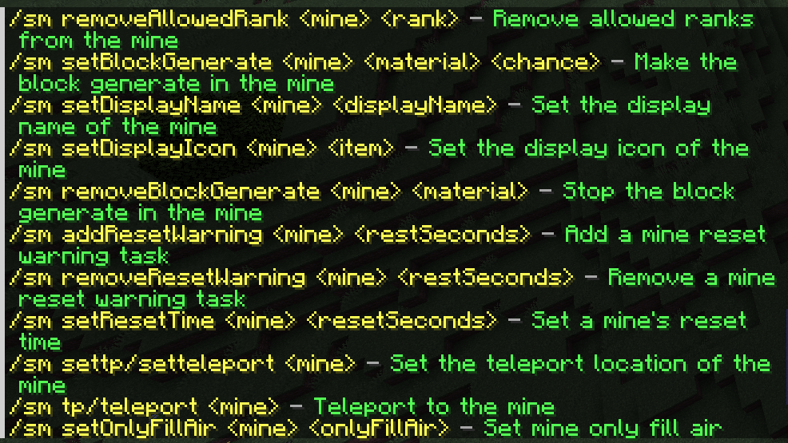
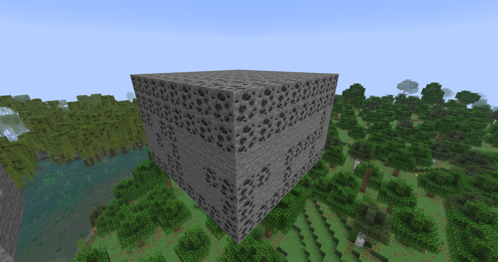
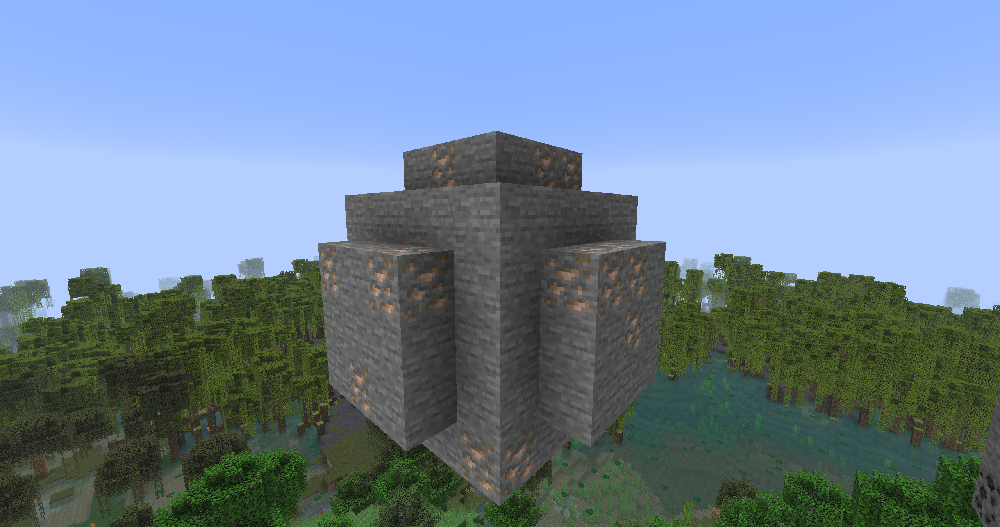
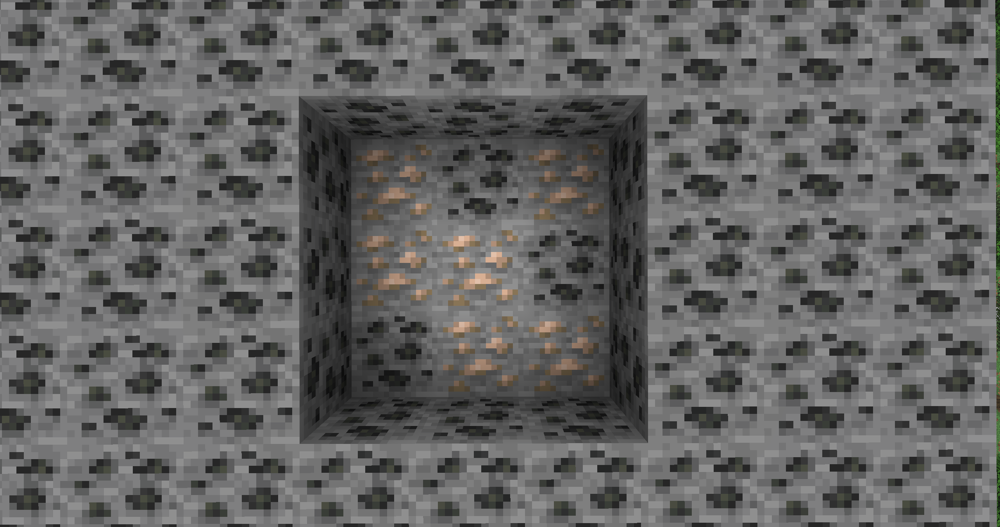

<div align="center">
<h1>SuperMines</h1>

SuperMines is a free, open-source mine plugin for Paper servers. It combines automatic resets, rule-based generation, and in-game management to reduce the repetitive work of running mines.
</div>

[简体中文](README_CN.md)

## Other Plugins' Pain Points

- **Limited generation rules**: many mine setups still revolve around a block-and-percentage pool, making it difficult to express surface, height, border, interior, or biome-based placement.
- **Configuration-heavy management**: adding blocks, changing weights, or editing a mine often means editing YAML and reloading the plugin.
- **Features spread across multiple plugins**: auto pickup, mining progression, treasure rewards, and individual respawn points are often handled separately, which spreads out configuration and permissions.
- **Full-mine resets only**: a scheduled reset of the whole selection does not cover independent ores, resource points, or different respawn schedules very well.
- **Limited extension points**: without combinable conditions and lifecycle events, it is harder to connect custom gameplay or let other plugins safely interact with mine operations.

## SuperMines's Highlights

- **2 mine shapes**: cuboid selections and spherical mines, both reset on a configurable schedule.
- **8 generation conditions**: surface, relative mine Y, border, biome, placeholder, plus AND, OR, and NOT combinations.
- **Independent regenerable points**: each point has its own timer, weighted block pool, persisted countdown, and independent `0-100%` treasure chances.
- **In-game management**: use GUIs to manage mines, block weights, generation conditions, treasures, ranks, and regen points.
- **A smoother mining loop**: per-mine and per-player auto pickup, block-based progression, and optional mcMMO / AuraSkills XP.
- **4 custom-block platforms**: ItemsAdder, Oraxen, Nexo, and CraftEngine.

## Migrating from CataMines / MineResetLite

1. Stop the server so the source plugin saves its data, then disable that plugin and keep its data directory.
2. Start the server with SuperMines and load the worlds containing your mines.
3. Run either command from the console or as a player with `supermines.migrate` (granted to operators by default):

   ```text
   /sm migrate CataMines
   /sm migrate MineResetLite
   ```

The importer reads YAML files in `plugins/CataMines/mines/` or `plugins/MineResetLite/mines/`, saves mines to `plugins/SuperMines/data/mines.yml`, and starts their reset schedules. It does not immediately fill mines; use `/sm reset <mineId>` when needed. The source plugin does not need to be installed or enabled, and its files are left intact.

Supported formats are CataMines 2.x (`Mine`, based on 2.5.11) and MineResetLite (`mine`). Imported settings include cuboid boundaries, block weights and states, reset intervals, warnings, air-only filling, and teleport locations. MineResetLite minutes are converted to seconds, incomplete compositions keep their remaining air percentage, and fixed surface blocks become generation conditions. Numeric block IDs such as `1:0` require WorldEdit or FAWE for conversion.

MineResetLite message modes are also imported. Keep `plugins/MineResetLite/config.yml` so its global broadcast settings can be saved as independent per-mine modes. Priority is:

| MRL setting | SM mode |
| --- | --- |
| Mine's `isSilent: true` | `SILENT` |
| `broadcast-nearby-only: true` | `IN_MINE` |
| `broadcast-in-world-only: true` | `IN_WORLD` |
| None enabled | `ALL` |

Original MRL's nearby option checks mine boundaries, not a distance radius. A missing or empty configuration uses MRL's original defaults; unreadable or invalid configuration stops migration with an error. Original MRL's `isSilent` only suppresses reset announcements, whereas SM's `SILENT` also suppresses warnings; migration reports this difference.

Existing mine IDs are skipped, including saved mines whose worlds have not loaded. Invalid data, unknown blocks, unloaded worlds, and creation cancelled by another plugin are reported and skipped. You can fix those entries and run the command again.

Custom loot tables, minimum tool efficiency, percentage-based resets, separate reset teleport destinations, and structure block exclusions need separate configuration; detected settings produce migration notices. Stopped CataMines mines and mines using only percentage-based resets keep automatic time resets disabled. The CataMines 3.x multi-region format is currently unsupported.

## Per-Mine Reset Messages

`mine.broadcast-reset-messages` uses `MessageBroadcastMode` as the default for new mines and older mines without an explicit setting:

- `ALL`: send reset and warning messages to all players.
- `IN_WORLD`: send only to players in the mine's world.
- `IN_MINE`: send only to players within the mine's world and boundaries.
- `SILENT`: send no reset or warning messages. Resets, teleports, and command feedback still work.

Cycle modes in the management GUI or run `/sm setBroadcastResetMessages <mineId> <ALL|IN_WORLD|IN_MINE|SILENT>` (case-insensitive). Each mine saves its mode as `messageBroadcastMode` in `data/mines.yml`. The `supermines.set_reset_message_broadcast` permission is granted to operators by default.

Default configuration:

```yaml
mine:
  broadcast-reset-messages: ALL
```

Legacy boolean configurations are accepted: `true` maps to `ALL`, and `false` maps to `IN_MINE`. The old per-mine `broadcastResetMessages` field is replaced by the enum field when saved. Invalid mine modes fall back to the default; an invalid global default falls back to `ALL`.

## Variables

> `[parameter]` means an optional parameter 
> `<parameter>` means a required parameter

### PlaceholderAPI

| Placeholder                                                | Returns                                                                                                                                  |
|------------------------------------------------------------|------------------------------------------------------------------------------------------------------------------------------------------|
| `%supermines_bestrank[_player]%`                           | The highest rank display name; uses the current player when `player` is omitted                                                          |
| `%supermines_biggestranklevel[_player]%`                   | The highest rank level; uses the current player when `player` is omitted                                                                 |
| `%supermines_minedblocks[_player]%`                        | The player's total mined blocks; uses the current player when `player` is omitted                                                        |
| `%supermines_hasrank_<rank_id>[_player]%`                  | Whether the player has the rank, returning `true` or `false`                                                                             |
| `%supermines_treasures_got_<treasure_id>[_player]%`        | How many times the specified treasure has been obtained; uses the current player when `player` is omitted                                |
| `%supermines_regenpoints_mined_<point_id>[_player]%`       | The player's blocks mined during the current reward cycle at the specified regen point; uses the current player when `player` is omitted |
| `%supermines_regenpoints_total_mined_<point_id>[_player]%` | The player's total blocks mined at the specified regen point; uses the current player when `player` is omitted                           |
| `%supermines_regenpoints_resettime_<point_id>%`            | Formatted time until the regen point respawns, or the localized generated status when it is ready                                        |
| `%supermines_mine_<mine_id>_<type>%`                       | Runtime data for a mine; see the type table below                                                                                        |

### MiniPlaceholders

| Placeholder                                                | Returns                                                                                                                                  |
|------------------------------------------------------------|------------------------------------------------------------------------------------------------------------------------------------------|
| `<supermines_bestrank[:player]>`                           | The highest rank display name; uses the current player when `player` is omitted                                                          |
| `<supermines_biggestranklevel[:player]>`                   | The highest rank level; uses the current player when `player` is omitted                                                                 |
| `<supermines_minedblocks[:player]>`                        | The player's total mined blocks; uses the current player when `player` is omitted                                                        |
| `<supermines_hasrank:<rank_id>[:player]>`                  | Whether the player has the rank, returning `true` or `false`                                                                             |
| `<supermines_treasures_got:<treasure_id>[:player]>`        | How many times the specified treasure has been obtained; uses the current player when `player` is omitted                                |
| `<supermines_regenpoints_mined:<point_id>[:player]>`       | The player's blocks mined during the current reward cycle at the specified regen point; uses the current player when `player` is omitted |
| `<supermines_regenpoints_total_mined:<point_id>[:player]>` | The player's total blocks mined at the specified regen point; uses the current player when `player` is omitted                           |
| `<supermines_regenpoints_resettime:<point_id>>`            | Formatted time until the regen point respawns, or the localized generated status when it is ready                                        |
| `<supermines_mine:<mine_id>:<type>>`                       | Runtime data for a mine; see the type table below                                                                                        |

### Mine Variable Types

| Type           | Returns                                     |
|----------------|---------------------------------------------|
| `blocksbroken` | Blocks mined during the current reset cycle |
| `resettime`    | Formatted time until the next reset         |
| `blockpercent` | Percentage of blocks remaining in the mine  |
| `minedpercent` | Percentage of the mine that has been mined  |
| `totalblocks`  | Total blocks in the mine                    |

If the mine does not exist, the result is `MINE_NOT_FOUND`.  
An invalid type returns `INVALID_ARGUMENT`.   
If the regen point does not exist, the result is `REGEN_POINT_NOT_FOUND`.

## What's Next

- Random mine events: lucky periods and double drops.
- Update checks.

## Screenshots

### Command Help



### Cuboid Mine



### Sphere Mine



### Border Condition: Core

The iron ore shown below is restricted to the interior of the mine.



## API
See [the API class](https://github.com/LinsMinecraftStudio/SuperMines/blob/main/src/main/java/io/github/lijinhong11/supermines/api/SuperMinesAPI.java)
