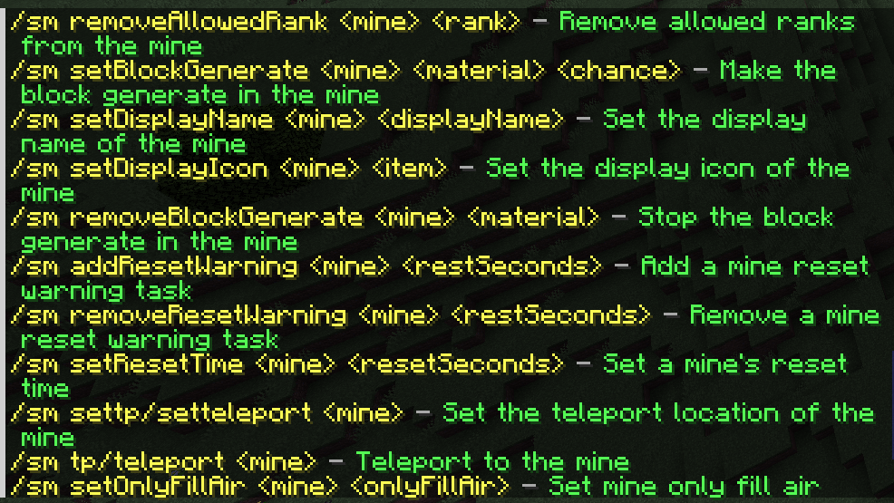
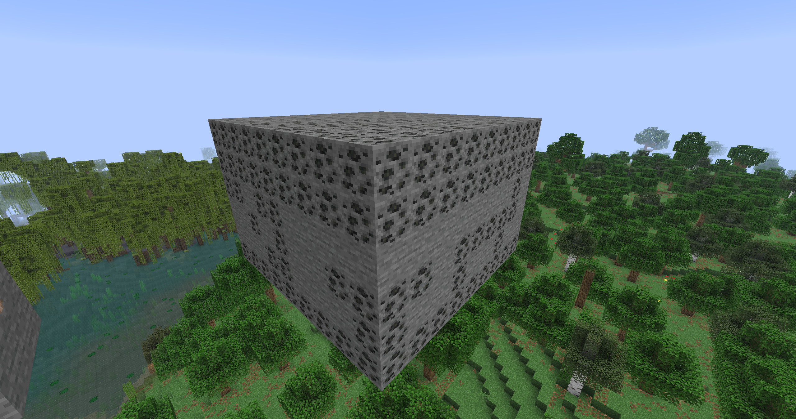
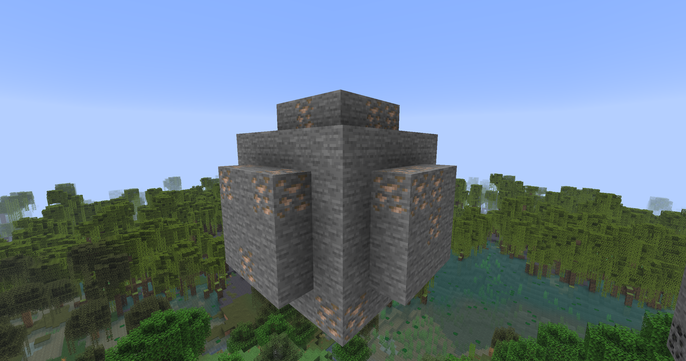
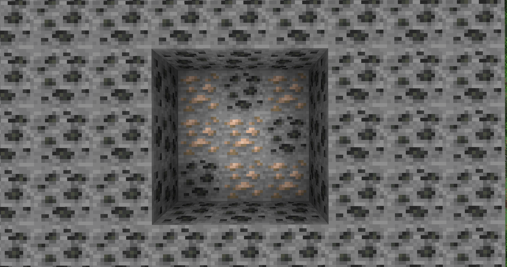

<div align="center">
<h1>SuperMines</h1>
</div>

<div align="center">
SuperMines 是一款免费开源的 Paper 矿区插件，用自动重置、条件化生成和游戏内管理，减少服主维护矿区的重复工作。
</div>

[English](README.md)

## 其他插件的痛点

- **生成规则单一**：不少矿区方案仍以“方块 + 百分比”的随机池为主，很难表达表层、指定高度、边界、内部或生物群系等位置规则。
- **管理依赖配置文件**：新增方块、调整权重或修改矿区时经常需要编辑 YAML、重载插件，日常运营不够直观。
- **功能被拆成多个插件**：自动拾取、挖掘等级、宝藏奖励和单点复生通常需要额外插件补齐，配置与权限容易分散。
- **只会整区重置**：传统矿区往往只能定时填充整个选区，难以处理独立矿石、资源节点或不同复生周期。
- **扩展能力有限**：缺少生成条件组合和完整事件 API 时，服主很难接入自定义玩法或让其他插件安全干预流程。

## SuperMines的亮点

- **2 种矿区形状**：支持长方体选区和球形矿区，并按设定周期自动重置。
- **8 种生成条件**：提供表层、矿区相对 Y、边界、生物群系、占位符，以及 AND、OR、NOT 组合条件。
- **独立可再生矿点**：每个矿点单独计时，支持加权方块池、持久化倒计时和 `0-100%` 独立宝藏概率。
- **游戏内管理**：通过 GUI 管理矿区、方块权重、生成条件、宝藏、等级和可再生矿点。
- **玩家挖矿体验**：支持矿区/玩家两级自动拾取、按挖掘量成长的等级，以及可选 mcMMO / AuraSkills 经验。
- **4 个自定义方块平台**：支持 ItemsAdder、Oraxen、Nexo 和 CraftEngine。
## 从 CataMines / MineResetLite 迁移

1. 停服并让旧插件保存数据，然后停用旧插件，保留其数据目录。
2. 启动安装了 SuperMines 的服务器，确保矿区使用的世界已经加载。
3. 在控制台或以拥有 `supermines.migrate` 权限的玩家执行（默认 OP 可用）：

   ```text
   /sm migrate CataMines
   /sm migrate MineResetLite
   ```

迁移会读取 `plugins/CataMines/mines/` 或 `plugins/MineResetLite/mines/` 中的 YAML 文件，将矿区保存到 `plugins/SuperMines/data/mines.yml`，并启动定时重置。命令不会立即填充矿区；需要时执行 `/sm reset <矿区ID>`。旧插件无需安装或启用，源文件不会被修改。

支持 CataMines 2.x（按 2.5.11 的 `Mine` 格式读取）和 MineResetLite 的 `mine` 格式：长方体范围、方块比例及方块状态、重置周期、预警时间、仅填充空气模式和传送点。MineResetLite 的分钟数会转换成秒；总比例不足 100% 时保留空气占比，固定表层方块会转换为生成条件。数字方块 ID（如 `1:0`）需要安装 WorldEdit 或 FAWE 才能转换。

已有同 ID 的矿区会跳过，包括世界尚未加载的已保存矿区。无效数据、未知方块、未加载的世界及被其他插件取消的创建会跳过并报告，修正后可重新执行命令。

自定义掉落表、工具效率限制、按剩余比例重置、独立的重置传送位置和结构方块排除规则需要另行配置；命令会对检测到的这些设置给出提示。仅按比例重置或已停止的 CataMines 矿区迁移后不会自动定时重置。当前不支持 CataMines 3.x 的多区域格式。

## 矿区重置消息

配置项 `mine.broadcast-reset-messages` 现在仅作为新矿区的默认值，以及旧矿区尚未保存独立设置时的兼容默认值。每个矿区可在管理 GUI 中切换，或使用 `/sm setBroadcastResetMessages <矿区ID> <true|false>` 单独设置。设为 `true` 时重置和预警消息发送给全服玩家；设为 `false` 时仅发送给矿区内玩家。修改权限为 `supermines.set_reset_message_broadcast`，默认 OP。

## 变量

> `[参数]` 表示可选参数  
> `<参数>` 表示必填参数

### PlaceholderAPI

| 变量 | 返回内容 |
| --- | --- |
| `%supermines_bestrank[_玩家名]%` | 最高等级的显示名；省略玩家名时读取当前玩家 |
| `%supermines_biggestranklevel[_玩家名]%` | 拥有的最高等级数值；省略玩家名时读取当前玩家 |
| `%supermines_minedblocks[_玩家名]%` | 累计挖掘方块数；省略玩家名时读取当前玩家 |
| `%supermines_hasrank_<等级ID>[_玩家名]%` | 是否拥有指定等级；省略玩家名时读取当前玩家，返回 `true` / `false` |
| `%supermines_treasures_got_<宝藏ID>[_玩家名]%` | 指定宝藏获取次数；省略玩家名时读取当前玩家 |
| `%supermines_regenpoints_mined_<矿点ID>[_玩家名]%` | 指定玩家在该矿点当前周期的挖掘数；省略玩家名时读取当前玩家 |
| `%supermines_regenpoints_total_mined_<矿点ID>[_玩家名]%` | 指定玩家在该矿点的累计挖掘数；省略玩家名时读取当前玩家 |
| `%supermines_regenpoints_resettime_<矿点ID>%` | 矿点重生的格式化剩余时间；矿点已生成时返回本地化的已生成状态 |
| `%supermines_mine_<矿区ID>_<类型>%` | 返回指定矿区的运行数据，类型见下表 |

### MiniPlaceholders

| 变量 | 返回内容 |
| --- | --- |
| `<supermines_bestrank[:玩家名]>` | 最高等级的显示名；省略玩家名时读取当前玩家 |
| `<supermines_biggestranklevel[:玩家名]>` | 拥有的最高等级数值；省略玩家名时读取当前玩家 |
| `<supermines_minedblocks[:玩家名]>` | 累计挖掘方块数；省略玩家名时读取当前玩家 |
| `<supermines_hasrank:<等级ID>[:玩家名]>` | 是否拥有指定等级；省略玩家名时读取当前玩家，返回 `true` / `false` |
| `<supermines_treasures_got:<宝藏ID>[:玩家名]>` | 指定宝藏获取次数；省略玩家名时读取当前玩家 |
| `<supermines_regenpoints_mined:<矿点ID>[:玩家名]>` | 指定玩家在该矿点当前周期的挖掘数；省略玩家名时读取当前玩家 |
| `<supermines_regenpoints_total_mined:<矿点ID>[:玩家名]>` | 指定玩家在该矿点的累计挖掘数；省略玩家名时读取当前玩家 |
| `<supermines_regenpoints_resettime:<矿点ID>>` | 矿点重生的格式化剩余时间；矿点已生成时返回本地化的已生成状态 |
| `<supermines_mine:<矿区ID>:<类型>>` | 返回指定矿区的运行数据，类型见下表 |

### 矿区变量类型

| 类型 | 返回内容 |
| --- | --- |
| `blocksbroken` | 当前重置周期内已挖掘的方块数 |
| `resettime` | 距离下次重置的格式化剩余时间 |
| `blockpercent` | 矿区剩余方块百分比 |
| `minedpercent` | 矿区已挖掘百分比 |
| `totalblocks` | 矿区总方块数 |

### 注意

矿区不存在时返回 `MINE_NOT_FOUND`，
类型无效时返回 `INVALID_ARGUMENT`，
矿点不存在时返回 `REGEN_POINT_NOT_FOUND`。

## 未来

下一步计划：

- 随机矿区事件：幸运时段和双倍掉落。
- 更新检查。

## 截图

### 指令帮助



### 长方体矿区



### 球形矿区



### 边界条件：内部

下图中的铁矿仅生成在矿区内部。



## API

请参阅 [API 类](https://github.com/LinsMinecraftStudio/SuperMines/blob/main/src/main/java/io/github/lijinhong11/supermines/api/SuperMinesAPI.java)
